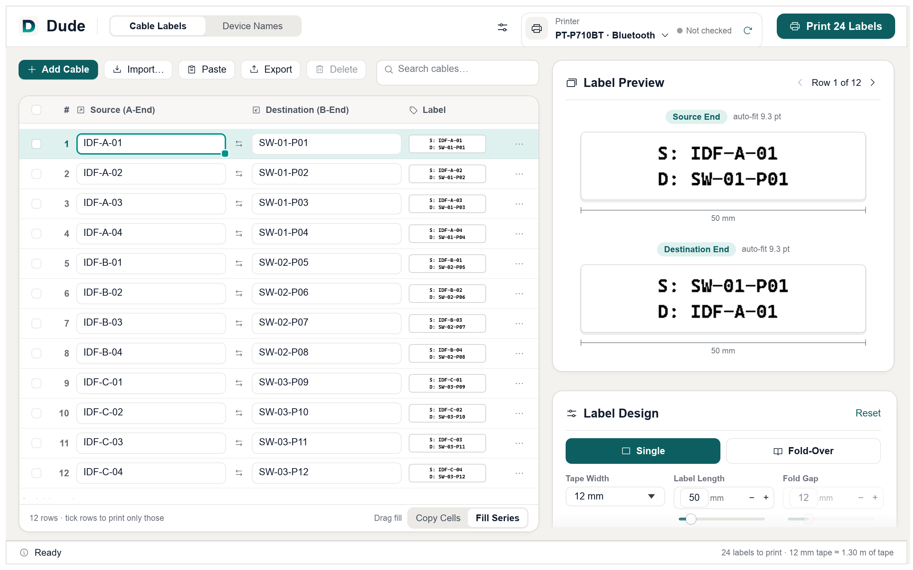

# Dude for Windows

Design and print cable and device labels on a **Brother PT-P710BT** label printer, over Bluetooth or USB.

## Download

**[Dude-Windows-1.0-1.zip](https://github.com/bestonehxh/Dude-Windows/releases/download/v1.0-1/Dude-Windows-1.0-1.zip)** — Windows 10 or later (64-bit)

1. Unzip and run `Dude.exe` — nothing to install.
2. The first time, Windows SmartScreen may say "Windows protected your PC": click **More info › Run anyway**.
3. **Bluetooth:** pair the PT-P710BT in Settings › Bluetooth & devices. **USB:** plug it in (the Brother driver isn't needed; close P-touch Editor if it's open).
4. Click the refresh button next to the printer to read the loaded tape.

Dude checks this page once a day and offers new versions, which are verified with a digital signature before they are installed.

> **1.0 (1) is a first test release for Windows.** Please report anything that doesn't work in [Issues](https://github.com/bestonehxh/Dude-Windows/issues).

## Features

- **Cable labels** (Source + Destination, each end lists its own name first) and **device names**.
- Paste rows from Excel, import/export CSV, drag a cell's corner to fill a number series.
- Exact print preview with dimensions in millimetres; text shrinks to fit.
- Single or fold-over labels, tape 6–24 mm, length 35–140 mm, font, spacing, alignment, padding.
- Check Printer reads the loaded tape; plain-language printer errors; progress and Stop.

Also for Mac: [Dude for macOS](https://github.com/bestonehxh/Dude).

Brother and P-touch are trademarks of Brother Industries, Ltd. Dude is an independent app and is not affiliated with or endorsed by Brother.
